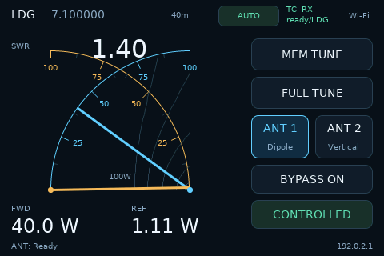
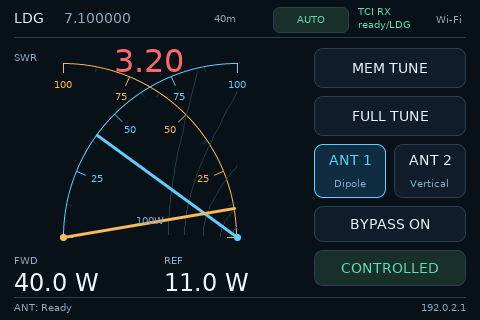
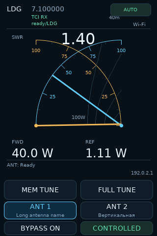
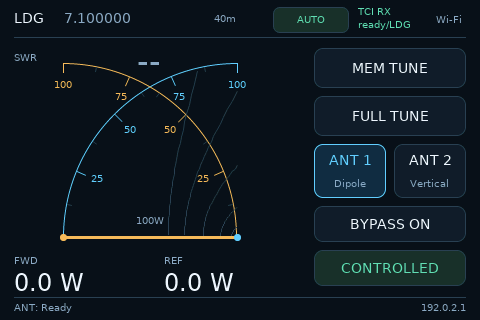
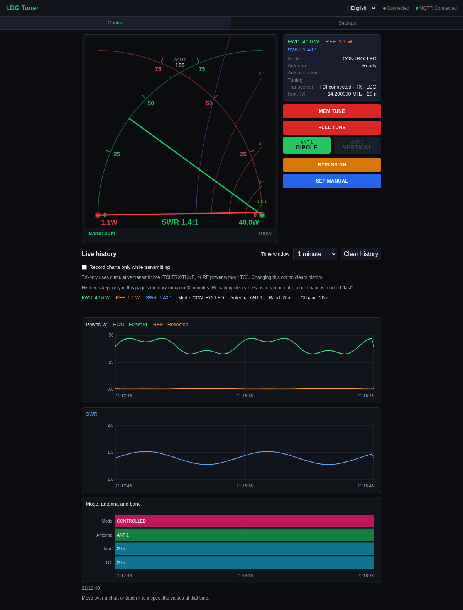
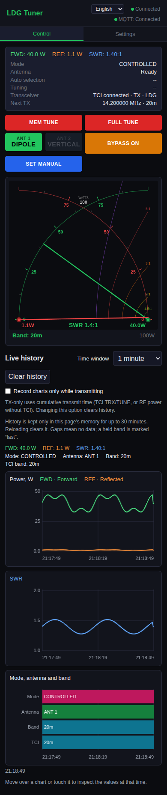
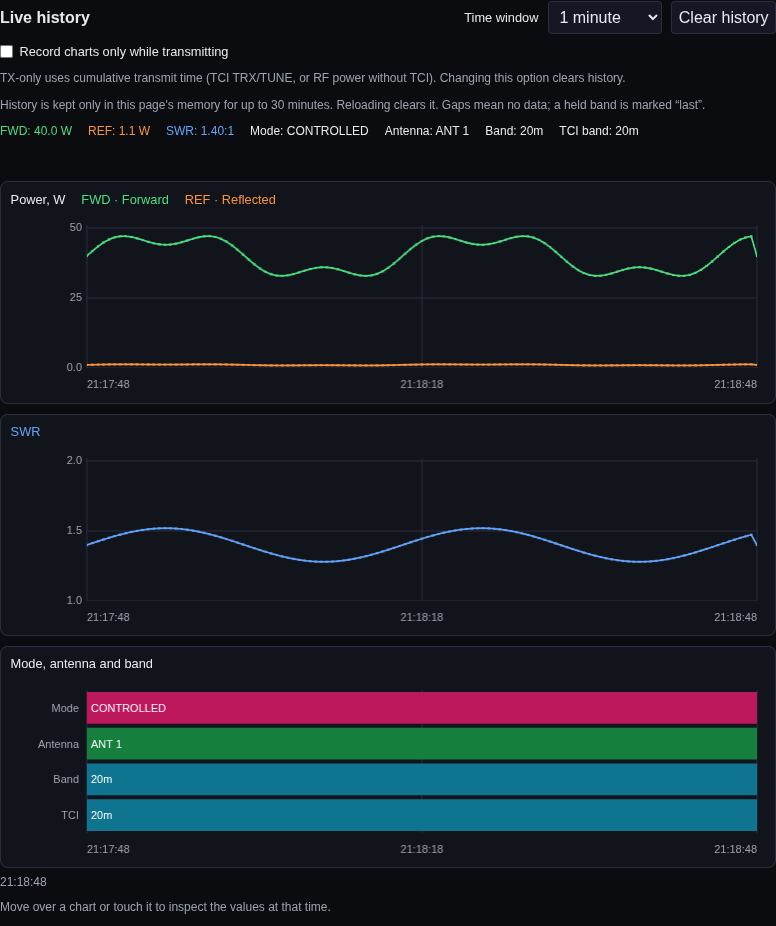
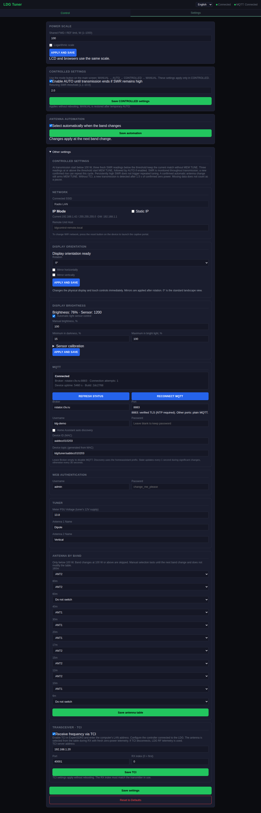
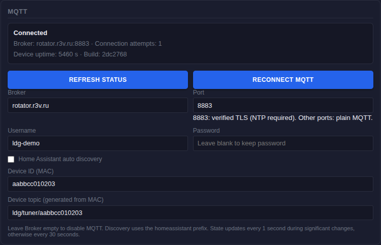

# LDG Tuner Remote Controller

ESP32 controller for LDG AT-1000ProII / AT-600ProII tuners, with a touchscreen,
a browser interface, MQTT and Home Assistant integration. Use one board beside
the tuner or a separate display connected over the local network.

## Features

- **Tuner controls:** MEM TUNE, FULL TUNE, BYPASS, ANT 1/2 and
  MANUAL → AUTO → CONTROLLED mode switching. Buttons show confirmed state and
  command progress.
- **CONTROLLED tuning:** checks three fresh SWR readings at transmission start.
  A good match keeps the current tuning; SWR at or above the configured threshold
  starts MEM TUNE. Optional AUTO fallback handles a remaining mismatch.
  A new confirmed SWR rise can start another cycle during the same transmission;
  continuously high SWR does not loop tuning.
- **Antenna automation:** a saved band-to-antenna table from 160 m to 6 m,
  manual overrides, startup antenna initialization and RF power guards.
- **Direct TCI:** receives frequency, split, XIT, RX/TX and TUNE from ExpertSDR3
  over the LAN. Selects the antenna for the future TX band while receiving.
- **Power and SWR:** crossed needles, digital FWD/REF readings, held band labels,
  a shared 1–1000 W range and linear or logarithmic scales.
- **New LCD layout:** dark blue panel, DejaVu Sans lettering, blue FWD and amber
  REF needles, SWR warnings, command feedback and TCI frequency. Supports
  landscape/portrait rotation, mirroring and Sunton automatic backlight control.
- **Browser interface:** responsive desktop/mobile controls, Russian/English
  switching, live WebSocket telemetry and HTTP status fallback. Controls load
  first; graphics and advanced settings load separately.
- **History charts:** FWD, REF, SWR, mode, antenna, LDG band and TCI TX band over
  1, 5, 15 or 30 minutes. TX-only recording uses accumulated transmit time and
  skips RX pauses. History stays in the browser.
- **MQTT with verified TLS:** port 8883 enables certificate and hostname
  verification. Supports managed LDG access through rotator.r3v.ru, per-device
  topics and MQTT API 2 for Logger Bridge.
- **Home Assistant discovery:** six sensors and seven command buttons per board,
  including CONTROLLED mode. Last readings remain available between RF bursts.
- **Setup and diagnostics:** Wi-Fi captive portal, saved settings, MQTT reconnect
  without reboot, uptime, reset reason and UART/network diagnostics.

## Screenshots

Interface previews with demonstration telemetry. LCD images use the application
renderer; browser images show the current generated web interface.

### Sunton touchscreen

| Cross-needle meter, 480×320 | High-SWR warning |
|---|---|
|  |  |

<details>
<summary>Portrait layout and idle meter</summary>





</details>

### Browser controls and history



<details>
<summary>Mobile controls, history and settings</summary>









</details>

## Hardware

| Build target | Board / display | Tuner UART RX / TX |
|---|---|---|
| `esp32-3248s035c` (default) | Sunton ESP32-3248S035C, ST7796 + GT911, 480×320 | GPIO35 / GPIO22 on P3 |
| `esp32-display` | ESP32 WROOM + BTT TFT35-SPI, ILI9488 + NS2009 | GPIO16 / GPIO17 |
| `esp32-remote` | ESP32 WROOM, no display | GPIO16 / GPIO17 |

All three provide the browser interface, MQTT, TCI and tuner control. Sunton uses
4 MB flash and internal RAM; PSRAM is not required. The Sunton `R` variant uses
a different resistive-touch controller and is not interchangeable with `C`.

The tuner interface is **38400 baud, 8N1, 5 V TTL**, requiring level conversion
for ESP32 GPIO. Mini-DIN pin 3 is tuner RX, pin 4 tuner TX and pin 2 ground.
**Pin 1 carries +12 V. Leave it insulated; do not use an S-Video cable.**
Power the ESP32/Sunton from regulated 5 V.

See the [soldering and wiring guide](WIRING.md),
[Sunton pinout](docs/boards/esp32-3248s035c.md), and diagrams for
[the tuner UART](docs/wiring/tuner-uart.svg),
[mini-DIN connector](docs/wiring/tuner-connector.svg),
[BTT display](docs/wiring/btt-display.svg) and [power](docs/wiring/power.svg).

## Installation

Download the images for your board from
[Releases](https://github.com/ra3vld/Remote-LDGControl/releases),
or build from source with PlatformIO. Each board needs matching **application
and LittleFS images**; the web interface is stored in LittleFS.

```sh
git clone https://github.com/ra3vld/Remote-LDGControl.git
cd Remote-LDGControl
npm ci --ignore-scripts --no-audit --no-fund
pio run -e esp32-3248s035c
pio run -e esp32-3248s035c -t upload --upload-port /dev/ttyUSB0
pio run -e esp32-3248s035c -t uploadfs --upload-port /dev/ttyUSB0
```

Install Node.js 18 or newer and PlatformIO first. Replace the environment and
serial port for your board; Windows ports use names such as `COM3`.
The build installs its pinned Arduino-ESP32 framework and generates web assets.
After updating, reload the browser page to load the matching interface.

For a manual first installation, write the separate image parts at these offsets:

| Image | Offset |
|---|---|
| Bootloader | `0x1000` |
| Partition table | `0x8000` |
| `boot_app0.bin` | `0xe000` |
| Application | `0x10000` |
| LittleFS | `0x390000` |

These are separate images, not a merged image for address zero. Select the
files with the same board suffix. Normal updates preserve settings; a full
flash erase removes Wi-Fi, credentials and saved configuration.

## First connection

1. Power the controller and join **LDGConfig**, password **configure**.
2. Open **http://192.168.4.1/** and enter your Wi-Fi details.
3. Open the controller's LAN address. mDNS names are
   `http://ldgcontrol-display.local/` for display builds and
   `http://ldgcontrol-remote.local/` for headless builds.
4. Sign in with **admin / change_me_please** and change the web password.
5. Set antenna names and the tuner's PSU voltage (default 13.8 V). This is the
   voltage feeding the tuner, separate from the ESP32's regulated 5 V supply.
6. Wait for antenna initialization and confirm the selected port before
   transmitting. The controller does not control the transceiver's PTT.

Settings for MQTT, antenna labels, PSU voltage, web credentials and remote host
apply without reboot. Wi-Fi/static-IP changes restart the controller.
Blank password fields preserve saved passwords. Configuration saves report
errors without replacing the active settings.

## Daily operation

Select MEM TUNE or FULL TUNE with an appropriate low-power carrier from your
transceiver. BYPASS ON enters bypass; BYPASS OFF returns the tuner to AUTO.
ANT 1/2 selects the named port; repeating an already confirmed selection does
not toggle the relay.

The mode button cycles MANUAL, AUTO and CONTROLLED. In CONTROLLED, configure
the SWR threshold and optional AUTO fallback in Settings. The controller
requires fresh positive RF before tuning; at or above 100 W it blocks a new
managed tuning cycle. See [CONTROLLED tuning](docs/tuning-control.md) for the
complete sequence and transmission detection rules.

Enable **Antenna by band** and save the table to choose ANT 1, ANT 2 or
**Do not switch** per band. Configure TCI on the controller attached to the tuner
for antenna selection during RX. See [TCI setup](docs/tci.md)
([по-русски](docs/tci-ru.md)) and [antenna selection](docs/tuner-protocol.md#startup-antenna-check-and-band-selection).

Click/touch the meter to switch the runtime 100/1000 W range. Settings can save a
custom 1–1000 W range and logarithmic scale. Rotation, mirrors and Sunton
brightness are described in [display settings](docs/display-settings.md).

The history panel sits below the controls. Inspect points with the pointer or
touch, choose a time window, or enable **Record charts only while transmitting**.
Changing the time basis clears history. Closing/reloading the page discards it;
no history is stored on the controller. See [history charts](docs/web-history.md)
and [language selection](docs/web-language.md).

## MQTT and Home Assistant

Leave **Settings → MQTT → Broker** empty to disable MQTT. Otherwise enter the
broker hostname, port and credentials. The device generates its Client ID and
base topic from its Wi-Fi MAC: `ldg-tuner-<mac>` and `ldg/tuner/<mac>`.
The header reports connection state; clicking it opens MQTT diagnostics and the
reconnect button. Usernames support 64 bytes and passwords 128 bytes.

**Port 8883 selects MQTT TLS** with certificate/hostname verification and no
plaintext fallback. The controller synchronizes time before connecting.
The included trust anchors are Let's Encrypt ISRG Root X1/X2. Other broker ports
use plaintext MQTT. This setting is independent of optional HTTPS for the web UI.

For **rotator.r3v.ru**, create an LDG device in the cabinet using the board's
12-digit Wi-Fi MAC. Copy the generated broker, port **8883**, login and password
into MQTT settings and disable Home Assistant discovery for that broker.

For your own Home Assistant broker, enable discovery. Each controller provides
six sensors (FWD, REF, SWR, band, mode, antenna) and seven buttons (antenna toggle,
MEM TUNE, FULL TUNE, BYPASS, AUTO, MANUAL, CONTROLLED). Availability follows the
online/offline topic; retained readings have per-measurement held flags.

See [MQTT topics, commands and discovery](docs/mqtt.md) and
[Logger Bridge MQTT API 2](docs/logger-bridge.md).

## Separate display and tuner

Set **Remote Unit Host** on the display to the tuner controller's IP/hostname.
Leave it empty for a locally attached tuner. Both boards need matching web
credentials and web HTTP/HTTPS configuration. The link uses authenticated
HTTP status requests and command POSTs; MQTT is optional.
See [remote-unit setup](docs/remote-unit.md).

## Access and diagnostics

The browser uses HTTP Basic Auth, request rate limiting and login lockout.
Keep the web port on the trusted LAN/VPN and change the default password.
Do not forward the controller's web port directly to the internet.

### Optional HTTPS

The standard web interface uses HTTP on port 80. To enable HTTPS on port 443,
add `-DTLS_ENABLED=1` to the selected environment's `build_flags` and rebuild.
The controller generates and stores a self-signed device certificate.
Open `https://192.168.4.1/` during setup and accept the certificate in a regular
browser. Linked display/tuner boards must use the same build setting.
**MQTT TLS on port 8883 works with the standard HTTP build.**

`GET /api/status` reports firmware identity, uptime, reset reason, MQTT state,
UART command results and display diagnostics. The USB console runs at
115200 baud. See the [HTTP/WebSocket API](docs/api.md) and
[BTT display troubleshooting](TROUBLESHOOTING-DISPLAY.md).

On the Sunton build, concurrent MQTT TLS and web traffic can produce intermittent
HTTP request failures. The browser provides retries; repeated failures appear
in connection diagnostics. Reduce extra polling clients when diagnosing them.

## Documentation

- [Wiring and power](WIRING.md)
- [Sunton ESP32-3248S035C](docs/boards/esp32-3248s035c.md)
- [Display, meter and backlight](docs/display-settings.md)
- [CONTROLLED tuning](docs/tuning-control.md)
- [TCI: English](docs/tci.md) / [Русский](docs/tci-ru.md)
- [Browser history](docs/web-history.md) and [language](docs/web-language.md)
- [MQTT / Home Assistant](docs/mqtt.md) and [Logger Bridge](docs/logger-bridge.md)
- [Remote units](docs/remote-unit.md)
- [HTTP/WebSocket API](docs/api.md) and [LDG serial protocol](docs/tuner-protocol.md)
- [Web assets and loading](docs/web-loading.md)
- [Development commands](docs/development.md)

## License and credits

Software: [GPL-3.0](LICENSE). Hardware designs:
[CC BY-SA 4.0](https://creativecommons.org/licenses/by-sa/4.0/). DejaVu font license:
[DejaVu](docs/licenses/DejaVu.txt).

Based on [Ben Kuhn's Remote-LDGControl](https://github.com/ben-kuhn/Remote-LDGControl).
Protocol reverse engineering: Efpophis and contributors
([LDGControl](https://github.com/Efpophis/LDGControl)); band thresholds: Ardugnome.
