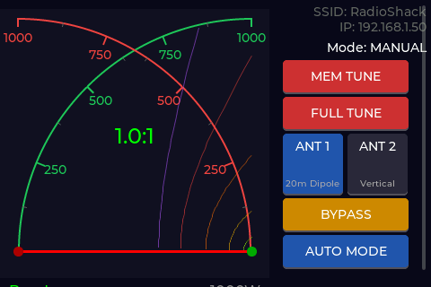
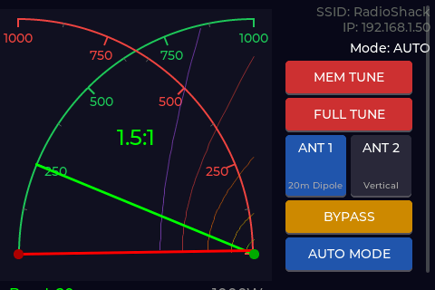
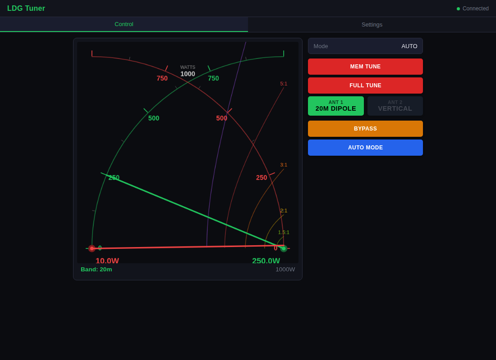
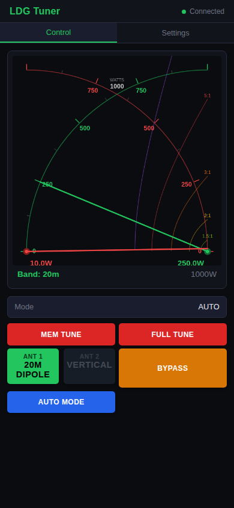
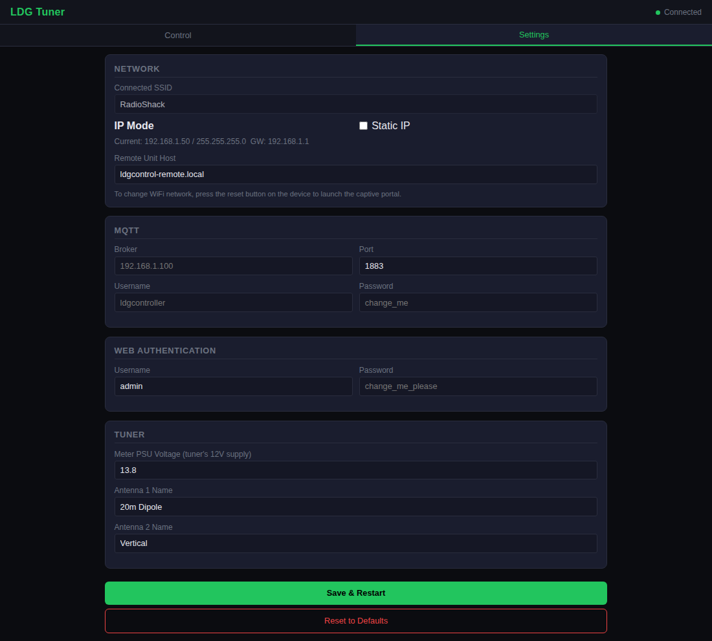
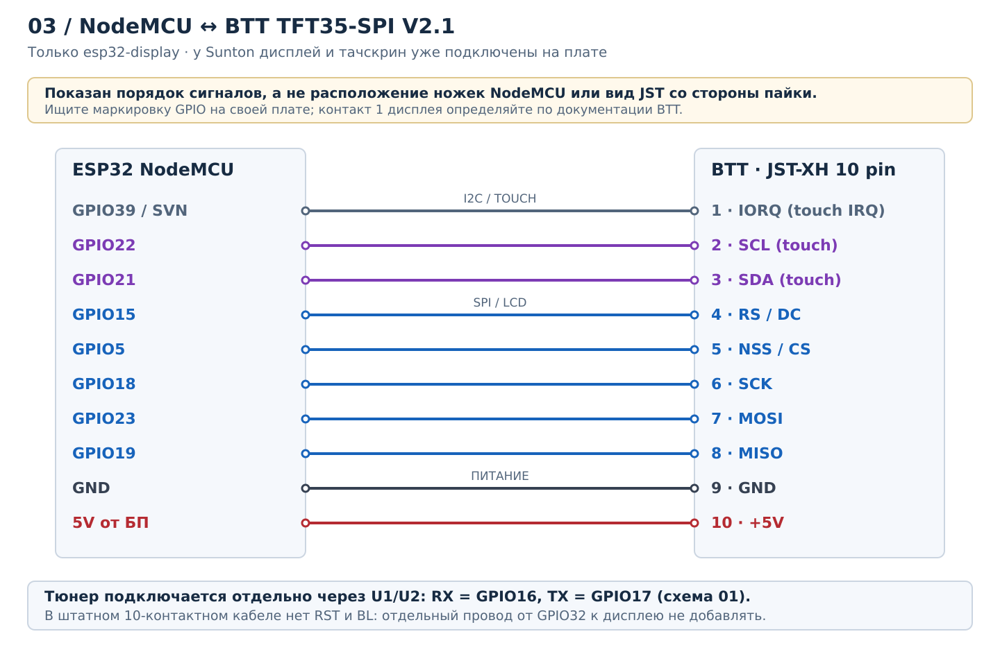

# LDG Tuner Remote Controller

ESP32-based remote control interface for LDG AT-1000ProII / AT-600ProII auto-tuners. Web UI, MQTT, optional touchscreen display, and remote unit support.

## Features

- **Tuner Control**: Full remote control via TTL serial interface
  - Memory Tune, Full Tune, Bypass
  - Auto mode selection
  - Antenna A/B switching
- **Real-time Metering**: Forward power, reflected power, SWR, band detection
  - Shared 100/1000 W scale: changing it on the touchscreen or in any browser
    updates the display and all connected pages. The scale starts at 1000 W
    after a device restart; switching it does not write settings to flash.
- **Web Interface**: Responsive browser UI with WebSocket live updates
- **MQTT Integration**: Per-device telemetry, adaptive 1/30-second updates, and Home Assistant auto discovery (six sensors and six command buttons)
- **Touchscreen Display**: Sunton ESP32-3248S035C or BTT TFT35-SPI with custom cross-needle meter
- **Three Firmware Targets**:
  - `esp32-3248s035c` (default): Sunton 3.5-inch ST7796 + GT911 capacitive touchscreen
  - `esp32-display`: Full unit with touchscreen (shack controller)
  - `esp32-remote`: Headless unit (web UI, MQTT, optional remote client capability)
- **Zero-Config Setup**: WiFi captive portal + web-based configuration — no recompiling needed
- **Security**: HTTP Basic Auth, rate limiting, login lockout

## Screenshots

UI previews with demo data: 250 W forward, 10 W reflected, SWR 1.5, and the 20m band.

### Sunton ESP32-3248S035C — 480×320

| Idle | Transmitting |
|---|---|
|  |  |

### Web interface



<details>
<summary>Mobile controls and settings</summary>





</details>

## Hardware

### Required
- Sunton ESP32-3248S035C, or ESP32 WROOM development board for the BTT/headless variants
- 4-pin mini-DIN connector for tuner interface (Kycon KMDLAX-4P)
- **WARNING**: Do NOT use S-Video cables — pins are wired differently and one carries +12V

### Optional (Display Unit)
- BTT TFT35-SPI display (ILI9488 controller)
- NS2009 I2C touchscreen (built into BTT TFT35)
- LM7805 linear regulator + TO-220 heatsink (powers ESP32 + display from 12V supply)

### Wiring

For the Sunton board, follow [ESP32-3248S035C wiring and installation](docs/boards/esp32-3248s035c.md).
Its tuner UART uses **RX GPIO35 / TX GPIO22 on P3**. The diagram and
quick-reference table below apply to the separate ESP32 + BTT hardware.

See [WIRING.md](WIRING.md) for complete details. Quick reference:



Additional diagrams: [tuner UART](docs/wiring/tuner-uart.svg),
[mini-DIN connector](docs/wiring/tuner-connector.svg),
[BTT display](docs/wiring/btt-display.svg),
[power supply](docs/wiring/power.svg).

The [LDG Meter Protocol (page 3)](https://github.com/Efpophis/LDGControl/blob/master/MeterProtocol.pdf)
defines mini-DIN **pin 3 as tuner RX** and **pin 4 as tuner TX**.
**Pin 1 carries +12V**; leave it disconnected and insulated in this build.
See WIRING.md for soldering tables and connector views.

| Connection | ESP32 Pin | Notes |
|------------|-----------|-------|
| Tuner GND | GND | Common ground |
| Tuner TX, mini-DIN 4 | GPIO 16 | Tuner TX → 5V-to-3.3V buffer → ESP32 RX |
| Tuner RX, mini-DIN 3 | GPIO 17 | ESP32 TX → 3.3V-to-5V buffer → tuner RX |
| 12V Supply | LM7805 IN | Separate 12V supply → 5V regulated |
| Display MOSI | GPIO 23 | Shared SPI bus |
| Display MISO | GPIO 19 | Shared SPI bus |
| Display SCLK | GPIO 18 | Shared SPI bus |
| Display CS | GPIO 5 | Display chip select |
| Display DC | GPIO 15 | Data/command |
| Touch SDA | GPIO 21 | I2C data (NS2009) |
| Touch SCL | GPIO 22 | I2C clock (NS2009) |
| Touch IRQ | GPIO 39 | Touch interrupt |
| Voltage Sense | GPIO 34 | ADC, 100k/22k divider (optional) |

RST and backlight are handled internally by the BTT TFT35-SPI V2.1 board — no external drive lines needed.

**Serial**: 38400 baud, 8N1, TTL (5V). Not RS-232.

## Install

### Option 1: Web Flasher (Recommended)

No software installation required. Works in Chrome, Edge, or Opera.

1. Visit the [Web Flasher](https://ben-kuhn.github.io/Remote-LDGControl/)
2. Connect your ESP32 via USB
3. Select your firmware variant and click **Install**
4. After flashing, the ESP32 creates a `LDGConfig` WiFi AP
5. Connect to it and open `http://192.168.4.1/` for WiFi setup
6. Once connected to your network, access the web UI at the assigned IP

### Option 2: Download Pre-built Firmware

Download the matching image parts from the [latest release](https://github.com/ben-kuhn/Remote-LDGControl/releases).
For Sunton, flash all five parts at their specified offsets:

```bash
esptool.py --chip esp32 --port /dev/ttyUSB0 write_flash \
  --flash_mode dio --flash_freq 40m --flash_size 4MB \
  0x1000 ldg-tuner-3248s035c-bootloader.bin \
  0x8000 ldg-tuner-3248s035c-partitions.bin \
  0xe000 boot_app0.bin \
  0x10000 ldg-tuner-3248s035c.bin \
  0x390000 ldg-tuner-3248s035c-littlefs.bin
```

For the BTT/headless variants, use `display`/`remote` image filenames at the same offsets.

### Option 3: Build from Source

```bash
pip install platformio

pio run -e esp32-display -t upload   # Display unit
pio run -e esp32-remote -t upload    # Remote/headless unit
pio run -e esp32-3248s035c -t upload # Sunton integrated touchscreen (default)
pio run -e esp32-3248s035c -t uploadfs # Web UI in LittleFS (required on first install)
pio device monitor                   # Serial console
```

The build pins PlatformIO Espressif32 6.12.0 (Arduino ESP32 2.0.17).
Run `pio test -e native -e native-display` for logic and LVGL rendering tests.
The display tests render the actual interface to an in-memory LCD, compare
incremental/full redraws pixel by pixel, and check both 100/1000 W scales.
See the [Sunton board guide](docs/boards/esp32-3248s035c.md) for pins, power,
and flash offsets.

## Configuration

All settings are configured through the web interface — no need to edit source code or rebuild.

### Initial Setup (Captive Portal)

After first flash, the ESP32 creates an AP named `LDGConfig` (password: `configure`).
Connect to it, stay connected if your phone reports no Internet, and open
`http://192.168.4.1/` in a browser. Captive-network probes redirect to this
address. The setup portal, runtime web UI and display-to-remote link use
plain HTTP on port 80 by default (`TLS_ENABLED=0`), without certificate
generation. In this mode, passwords and HTTP Basic Auth credentials are
transmitted without transport encryption.
The portal's periodic log includes `internal_free` and `internal_max` (the
largest free block); total free heap alone does not show fragmentation.

### Optional TLS

Add `-DTLS_ENABLED=1` to the selected environment's `build_flags` in
`platformio.ini` to enable HTTPS on port 443 for the setup portal, runtime
web UI and display-to-remote link. Both linked units must use the same setting.
Without this flag, all three use HTTP on port 80.

TLS builds generate a device certificate on first use and retain it in NVS.
Open `https://192.168.4.1/` for setup and accept the self-signed certificate
warning in a regular browser. Captive HTTP requests redirect to that address.
The setup server permits one TLS session at a time and closes each response;
the runtime permits two sessions to leave room for WebSocket plus commands.

### Web Configuration

Once on your network, go to `http://<esp32-ip>/` and log in (default: `admin` / `change_me_please`).
For TLS builds, use `https://<esp32-ip>/` instead.

Go to **Settings** (or `GET /api/config`) to configure:

| Setting | Description |
|---------|-------------|
| WiFi SSID / Password | Your network credentials |
| MQTT Broker | Hostname or IP of your MQTT broker |
| MQTT Port | Broker port (default 1883) |
| MQTT Username / Password | Broker authentication; leave password blank to preserve it |
| Home Assistant auto discovery | Enabled by default; discovery prefix is `homeassistant` |
| Device topic | Read-only base topic generated from the board's full MAC address |
| Web Username / Password | Web UI authentication |
| Meter PSU Voltage | Tuner's power supply voltage for accurate power calculation (default 13.8V). This is the voltage at the tuner's 12V input, not the ESP32's supply. |
| Remote Unit ID | ID for remote unit (default 1) |

Settings are validated and saved as one versioned NVS blob before replacing
the running configuration. Existing per-key settings are read on upgrade and
migrate on the next successful save. A failed save reports an error without
restarting. MQTT, tuner labels, PSU voltage, web credentials and remote-host
settings apply without restarting the display. Changes to the Wi-Fi/static-IP
configuration still require a restart. DHCP values shown in the static-IP form
do not trigger a restart while DHCP remains selected.

### Reset to Defaults

If you need to reconfigure WiFi, press and hold the BOOT button on the ESP32 for 5 seconds, or call `POST /api/config` with `{"reset": true}`.

## Web Interface

Access at `http://<esp32-ip>/` or `http://ldg-tuner-<mac>.local/`

### API Endpoints

All endpoints require HTTP Basic Auth.

| Method | Endpoint | Description |
|--------|----------|-------------|
| GET | `/` | Web UI |
| GET | `/api/status` | JSON status, MQTT diagnostics, `uptime_ms`, `reset_reason`, and `firmware_build` |
| POST | `/api/mqtt/reconnect` | Ask the MQTT worker to reconnect without restarting the device |
| POST | `/api/meter-scale` | Set the shared scale with `{"meter_scale":100}` or `{"meter_scale":1000}`, or switch it with `{"toggle":true}` |
| GET | `/api/config` | Current configuration |
| POST | `/api/config` | Save/apply configuration; `restart` is true only when network settings require it |
| POST | `/api/command/toggle` | Toggle antenna A/B |
| POST | `/api/command/antenna_1`, `/api/command/antenna_2` | Select the requested antenna; repeated requests are idempotent |
| POST | `/api/command/memory_tune` | Memory tune |
| POST | `/api/command/full_tune` | Full tune |
| POST | `/api/command/bypass` | Bypass (passthrough) |
| POST | `/api/command/auto` | Set auto mode |
| POST | `/api/command/manual` | Set manual mode |

The scale endpoint returns `meter_scale` and `meter_scale_revision`. Both fields
are also included in `/api/status` and live WebSocket meter updates, including
when the tuner is idle. Invalid scale requests return HTTP 400. To install this
feature, upload both the application and LittleFS (`uploadfs`) and reload the
browser page. Run `pio test -e native`, `node tests/test_meter_scale_web.cjs` and
`node tests/test_control_web.cjs`
for the shared-state and page synchronization regression checks.
`node tests/test_settings_web.cjs` checks runtime saves, MQTT reconnect,
single status polling and uptime diagnostics.

ANT 1/ANT 2 select the named port; they are not two copies of the hardware
toggle. Repeated confirmed selections do not switch relays. The mode button
offers Set Manual while AUTO is confirmed and Set Auto otherwise. The LCD
shows waiting/OK/not confirmed for commands; waiting persists until completion.
The bypass button enables bypass (`P`); no bypass-off command is documented.

### WebSocket telemetry

The browser obtains a single-use token from authenticated `GET /api/ws-token`,
then opens `/api/ws?t=<token>` for JSON meter snapshots. The `/api/events` SSE
route is not used. HTTP Basic Auth protects the page, status, token and command
endpoints.

## MQTT and Home Assistant

MQTT is optional: leave **Settings → MQTT → Broker** empty to disable it.

The header shows live MQTT status; click it to open **Settings → MQTT** for the
active broker, connection attempts, retry delay, and errors with PubSubClient
codes. Status refreshes every 3 seconds, independently of meter readings. The
last error remains visible as recovered after a successful reconnect or retry.
If the device cannot be reached, the UI marks the live status unavailable.
`GET /api/status` exposes the same diagnostics under `mqtt`. The Serial console
(115200 baud) logs `[MQTT]` connection attempts, state changes, transport errors,
and recovery without printing passwords. Repeated identical send errors are
logged once until recovery. Publish/subscribe success means the request was sent;
it does not confirm broker ACL acceptance or Home Assistant discovery.
Otherwise set the broker address, port (default `1883`), and optional credentials.
Leaving the password field blank when saving settings preserves the stored password.
Settings are saved in NVS and applied by the MQTT worker without restarting
the device. **Refresh status** reads diagnostics; **Reconnect MQTT** requests
a new broker connection without rewriting settings or resetting the LCD.
The hostname passed to PubSubClient belongs to the handler for the full
connection lifetime. The transport is plain MQTT; MQTT TLS is not implemented.

Enable the MQTT integration in Home Assistant against the same broker, with its
default discovery prefix `homeassistant`. **Home Assistant auto discovery** is
on by default in the controller's web settings, including after upgrading older
configurations. Each controller creates one HA device with:

- Sensors: forward power (W), reflected power (W), SWR, band, mode, and antenna.
- Buttons: Memory Tune, Full Tune, Bypass, Toggle Antenna, Auto Mode, Manual Mode.

Mode values are `auto`, `manual`, `bypass`, or `unknown`; antenna values are `A`,
`B`, or `unknown`. Numeric readings are `null` until received or when non-finite.
Mode and antenna update from tuner responses. Availability indicates the
controller's MQTT connection. Buttons report the command executor's result.

### Device topics

The base topic is `ldg/tuner/<mac>`, where `<mac>` is the full station MAC address
in lowercase with no separators (for example `ldg/tuner/aabbcc010203`). Find the
actual base topic in Settings or `GET /api/config` (`mqttBaseTopic`).

**Migration:** the former shared `ldg/tuner/...` and `ldg/tuner/remote/...` topics
are no longer published or subscribed. Update existing MQTT clients and automations.
Display ↔ remote communication uses HTTP status polling and command POSTs (HTTPS with
`TLS_ENABLED=1`) and needs no MQTT broker.

| Topic relative to the base | Direction | Payload / retention |
|---|---|---|
| `/state` | Published | Last observed measurement JSON, retained |
| `/status` | Published | `online` / `offline`, retained; Last Will is `offline` |
| `/command` | Subscribed | Command JSON; publish with QoS 0 and retain disabled |
| `/command/response` | Published | Command result JSON, not retained |

Example `/state` payload:

```json
{"fwd_power":250,"ref_power":10,"swr":1.5,"fwd_raw":375,"ref_raw":75,"band":"20m","mode":"auto","antenna":"A","source":"local"}
```

The snapshot always uses the active tuner. A display controller follows the
remote tuner, including its band, mode, and antenna, while connected; it falls
back to its local UART tuner after a 3-second remote timeout. Local meter readings
also expire after 3 seconds without a valid UART frame. While a remote command
is running, its source stays selected even if polling is paused for a long tune;
stale meter values still expire. `source` is `local` or `remote`. Commands follow the same active source.

Home Assistant keeps the last observed power, SWR and band between RF bursts.
Each measurement has a `held` attribute: `true` means the displayed value is
being kept because no current valid value is available. A valid zero-power
packet updates power to zero; an undefined SWR or unknown band keeps the last
valid reading of that measurement. Before the first observation, the value is
still unknown. `/state` also includes `telemetry_fresh` and a per-measurement
`held` object. The web UI, LCD and HTTP live telemetry retain their existing
three-second freshness check for power and SWR. The LCD also shows digital
forward/reflected power in watts; missing readings show `--`, while real zero
power shows `0.0W` independently of the selected dial scale.
The dial radius, needle length and spacing between needle pivots are equal,
including the 300x280 LCD dial. Thus each zero-scale endpoint meets the
opposite pivot; reducing the dial height also moves its pivots inward.

The last detected band is kept separately in the source snapshot, so the LCD
and browser also keep it between transmissions. They mark it `(last)` when
the current frame has no known band or telemetry has expired; HTTP/WebSocket
snapshots expose the same distinction as `band_held`. A new valid band replaces
it immediately. This history is not shared between local and remote sources.

The MQTT worker observes readings while offline and keeps them across MQTT
reconnect/reconfiguration. Retained `/state` lets HA restore the last published
snapshot when subscribing again; availability still follows the separate
`online`/`offline` topic. History is in RAM, is cleared on a controller reboot,
and resets when the active source changes so local and remote readings cannot
be mixed. Command requests and responses remain non-retained. Existing HA
entities receive the updated discovery configuration without recreation.

Local antenna and mode values retain the last acknowledged command when RF
telemetry goes quiet, including during a long tuning cycle. A telemetry timeout
does not mean the antenna relay changed. `connected` and meter validity still
expire independently. Selecting the same known antenna never toggles its relay;
after a connection timeout it first checks communication with `Z`. A failed or
missing antenna/mode acknowledgement still makes that control state unknown.
The protocol cannot read back changes made at the tuner's front panel.

### Diagnosing unstable meter readings

`GET /api/status` includes a bounded `uart` diagnostic snapshot for this board's
**local UART**, even when the active meter `source` is `remote`:

- `rx_bytes`, `frames`, `framing_errors`, `resyncs`: processed bytes, complete
  meter packets, invalid packet trailers, and recovered packet boundaries.
- `errors`: driver events for RX buffer full, FIFO overflow, UART frame/parity
  errors and break conditions. Counters are cumulative since boot.
- `last_frame_hex`: the last accepted 6-byte payload plus `3b3b`, in wire order;
  `forward_raw`, `reflected_raw`, `band_raw`, `psu_voltage`, and `frame_age_ms`
  describe that same packet. The top-level active snapshot is read separately
  and can already refer to another packet or to the remote tuner.
- `rx_tail_hex`: the last 32 processed bytes, including rejected data and replies.
  This fixed-size tail can start or end inside a packet.
- `last_command`: the latest completed UART command, its matching `ack`
  (`null` when not received, `sync` for a complete Z response), `success`, and
  `duration_ms`. Success also requires restoring metering; a failed tune is
  reported as unsuccessful even when its `F` acknowledgement arrived.
  `exchange` identifies the last attempted exchange (`Z` if recovery sync
  prevented the requested command), `written` reports its transport write,
  and `meter_restarted` reports the final `S` write. `error` distinguishes
  `meter_stop_failed`, `write_failed`, `uart_error`, `timeout`,
  `meter_restart_failed` and `tune_failed` (or is null on success).
  `rx_hex` freezes the last 32 bytes received during that exchange, including
  rejected bytes, and `rx_bytes` gives the full count. Subsequent meter frames
  do not overwrite this trace. Capture this object after separate AUTO/BYPASS
  attempts when diagnosing unconfirmed commands; do not infer success from
  writing a command or accept an undocumented acknowledgement.
  `timeout_ms` gives the response deadline and `wait_ms` the actual response
  wait, excluding stop/start metering and inter-command guards.

Capture several status responses while the RF input and frequency are constant.
Compare top-level `fwd_raw` / `ref_raw`, the wire bytes, frame counters and driver
errors before attributing jumps to the display. LDG meter packets have no
checksum: a complete packet alone does not prove its payload is uncorrupted.
The firmware discards a receive batch associated with a driver error, then
resynchronizes; it does not clamp readings to the selected display scale.

The UART RX ring is 2048 bytes: a 250 ms command-settling wait can receive
960 bytes at 38400 baud, exceeding the framework's default 256-byte ring.
This prevents that particular overflow; the actual tuner rate and line quality
still require device verification.

Entering control mode drains the old metering batch after `X` and retires its
pending UART fault. A fault from already discarded telemetry must not reject
a clean AUTO/MANUAL/BYPASS acknowledgement. New faults during the command
exchange still fail the command and require synchronization before recovery.

Application and web UI are separate flash images. Upload the matching LittleFS
image with `pio run -e esp32-3248s035c -t uploadfs` and reload the browser after
updating firmware. The current web buttons say `Enable bypass` and `Set Auto`
or `Set Manual`. Older `Bypass` / `Auto Mode` labels indicate an older loaded
page or filesystem. Bypass enables passthrough; no bypass-off command is
documented. The AUTO/MANUAL button changes the tuning policy and is not a
verified bypass-off operation.

### Adaptive state updates

State is sent at most once per second during significant changes, and every
30 seconds otherwise, including unchanged or zero-power readings. Changes are
compared with the last successfully sent snapshot, so small changes accumulate.
Any of these triggers the fast interval:

| Measurement / state | Significant change |
|---|---|
| Forward power | At least `max(1 W, 1% of the previous value)` |
| Reflected power | At least `max(0.1 W, 1% of the previous value)` |
| SWR | At least `0.05` |
| Either power reading | Zero ↔ nonzero transition, regardless of size |
| Band, mode, antenna, source, or value validity | Any change |

Intermediate changes are coalesced into the latest snapshot. First connection,
reconnection, Home Assistant discovery, and completed web/MQTT commands request an
immediate state update. A failed publish does not advance the timer or baseline.
Thresholds are fixed in firmware. WebSocket and display refresh rates are unchanged.

### Commands and discovery lifecycle

Send commands such as `{"command":"full_tune"}` to the per-device `/command`
topic. Supported commands: `toggle`, `memory_tune`, `full_tune`, `bypass`, `auto`,
`manual`. Responses contain `command` and `result`: `success`, `failed`,
`invalid_json`, `missing_command`, or `unknown_command`. Commands are not retried
automatically and must not be retained.

Discovery configurations are retained at
`homeassistant/<sensor|button>/ldg_<mac>/<entity>/config`. Entity and device IDs
stay stable across restarts and firmware variants. Configurations and current
state are resent after a broker reconnect or HA's `homeassistant/status = online`.
Each board subscribes only to its own command topic and HA's birth topic.

Turning auto discovery off (`mqttDiscoveryEnabled: false` in `POST /api/config`)
removes this board's retained discovery configurations on its next connection;
normal MQTT state and commands remain available. Keep the broker configured and
reachable until cleanup completes. Disabling MQTT or switching brokers cannot
remove old discovery records from an unreachable/previous broker; remove those
records there manually if needed.

### Verification

`pio test -e native` runs the existing touch tests plus MQTT scheduling, JSON,
command, active-source, and simulated-broker lifecycle tests. The MQTT tests cover
12 entities per board, two independent boards, HA/broker restarts, retained-config
cleanup, zero readings, failed writes, and `millis()` wraparound.
For checks with Home Assistant and an MQTT broker, see
[the MQTT smoke-test checklist](tests/mqtt-smoke.md).

## Protocol Reference

### Serial Communication

- **Baud**: 38400
- **Format**: 8N1
- **Levels**: TTL (5V)

### Command Sequence

1. Stop telemetry with `X` (preceded by wake), allow 250 ms to settle, and drain the final meter bytes.
2. Send wake: two space characters (`0x20`) with 1 ms delay, then the command byte.
3. Read the command-specific acknowledgement. Memory/full tuning waits up to
   20 seconds because a full cycle can take 15 seconds and memory tuning can fall back to it.
4. Wait 250 ms **after receiving the acknowledgement**, then wake and restore telemetry with `S`.

AUTO/MANUAL/BYPASS replies have a 2200 ms deadline, matching the response window
in [NeoLDG](https://github.com/RiskAndReward1337/NeoLDG/blob/main/src/LdgTunerController.cpp).
The former 500 ms limit could restart metering before a delayed mode ACK arrived;
this does not prove that every reported missing ACK is a delayed response.
Antenna replies retain their 500 ms deadline; `Z` has a 1-second deadline and
must match the complete synchronization string below. Unknown bytes do not
acknowledge a command or establish a connection. A failed tune (`F`) is a valid
reply but reports an unsuccessful operation. After a missing response, a full
`Z` exchange must succeed before another control command is sent, so a late
reply cannot be mistaken for the next operation's result. Commands are not retried.

### Commands

| Byte | Function | Response |
|------|----------|----------|
| ` ` (0x20) | Wake (send 2x) | None |
| `A` | Toggle antenna | ASCII `1` or `2` (application/UI names remain `A`/`B`) |
| `T` | Memory tune | `T` (good), `M` (okay), `F` (fail) |
| `F` | Full tune | `T`, `M`, `F` |
| `P` | Bypass (passthrough) | `P` |
| `C` | Auto mode | `A` |
| `M` | Manual mode | `M` |
| `Z` | Sync receive stream | `000000000000000AzAz` (15 ASCII zeroes followed by `AzAz`) |
| `S` | Start meter telemetry | None |
| `X` | Stop meter telemetry | None |

`Z` does not return operating mode or antenna status. These values are known
only from acknowledged control commands; changes made at the tuner's front
panel cannot be discovered from the power telemetry. `P` confirms bypass;
the protocol specification does not promise a toggle or report an exit state.

### Meter Telemetry

6 bytes + `;;` (0x3B3B) end-of-message marker:

| Bytes | Description | Byte Order |
|-------|-------------|------------|
| 0-1 | Forward power (raw) | Big-endian |
| 2-3 | Reflected power (raw) | Big-endian |
| 4-5 | Band indicator | Big-endian |

### Power Calculation

```
P = ((1000 * V_psu * raw) / (65536 * 0.707))^2 / 50
```

Where `V_psu` is the tuner's power supply voltage (configurable via web UI, default 13.8V).

SWR uses the raw amplitude ratio: `(fwd_raw + ref_raw) / (fwd_raw - ref_raw)`.
With no forward power, or reflected power greater than or equal to forward
power, SWR is unknown (`null` in JSON, `--` on screen). Power readings remain
available. Such readings must not be displayed as a good 1:1 match.

### Band Detection

| Band | Indicator Range |
|------|----------------|
| 160m | 8230 - 9145 |
| 80m  | 4110 - 4710 |
| 60m  | 3060 - 3080 |
| 40m  | 2250 - 2355 |
| 30m  | 1600 - 1630 |
| 20m  | 1140 - 1180 |
| 17m  | 900 - 915 |
| 15m  | 766 - 782 |
| 12m  | 655 - 662 |
| 10m  | 550 - 590 |
| 6m   | 320 - 360 |

## Remote Unit Link

When the tuner is located near the antenna (e.g., in a shack attic or external enclosure), use a remote unit configuration.

### Architecture

Both controllers join the same reachable Wi-Fi network. In the display unit's
Settings, set **Remote Unit Host** to the headless unit's IP or hostname. Keep
it empty for a directly attached tuner (the default for new configurations).
Both units must use matching web credentials and `TLS_ENABLED` values.

The display polls the remote unit's authenticated `GET /api/status` every
500 ms and sends commands to its `/api/command/*` endpoints. Browsers use
WebSocket telemetry independently. The link needs no MQTT broker or SSE route.
A peer already following another remote source is rejected to prevent loops.
Tuning HTTP requests allow 25 seconds; browser commands allow 30 seconds for
the UART cycle and remote hop. The remote status poll retains its 3-second
timeout. A completed remote command is followed by a status poll.

UART parsing, local commands, remote networking, MQTT, web serving and LVGL
have separate owners. Display buttons enqueue commands without waiting for
UART or DNS. All interfaces select the same active tuner. A queued remote
command fails if its source disappears; it is never redirected to the local
tuner. Lost command responses are not retried automatically.

The wire protocol provides antenna toggle only. When the initial antenna is
unknown, an absolute selection may require two acknowledged toggles to reach
the requested port. Repeated requests for a confirmed port do not toggle it.

### MQTT (Optional)

Both units can independently connect to a broker and appear as separate Home
Assistant devices. Each uses its own `ldg/tuner/<mac>/...` topics. A display
controller publishes its active tuner; the headless unit publishes its local
tuner. MQTT does not carry the display ↔ remote link; that remains HTTP status polling and command POSTs
(HTTPS with `TLS_ENABLED=1`).

## Security

### Threat Model

The controller uses the following security controls:

1. **HTTP Basic Auth** on all web endpoints
2. **Rate limiting** (10 requests/second per IP)
3. **Login lockout** (5 failed attempts = 5 minute ban)
4. **MQTT authentication** (username/password)
5. **No open relays** — device doesn't proxy or forward

### Hardening Recommendations

- **Never** port-forward the HTTP port to the internet
- Change the default web password immediately
- Place on an isolated IoT VLAN if possible

## Build Matrix

| | `esp32-display` | `esp32-remote` |
|---|---|---|
| RAM | ~118KB (36%) | ~48KB (15%) |
| Flash | ~1.1MB (63%) | ~960KB (52%) |
| Touchscreen | Yes | No |
| Web UI | Yes | Yes |
| MQTT | Yes | Yes |
| Remote Link | Server | Optional Client |

`esp32-3248s035c` provides the display variant's features using the onboard
ST7796/GT911, 4 MB flash and internal RAM (no PSRAM required).

## CI/CD

This project uses GitHub Actions for automated builds:
- Every push to `main` runs native touch tests and builds all three firmware variants and their LittleFS images
- Tags (e.g., `v1.0.0`) create a GitHub Release with pre-built binaries
- The `main` branch deploys the web flasher to GitHub Pages

## License

Software: [GPL-3.0](LICENSE)
Hardware designs: [CC BY-SA 4.0](LICENSE-HARDWARE)

## Credits

- Protocol reverse engineering: Efpophis and contributors ([LDGControl](https://github.com/Efpophis/LDGControl))
- Meter power formula: Community-contributed (see LDGControl source)
- Band detection thresholds: Ardugnome (LDGControl, November 2022)
