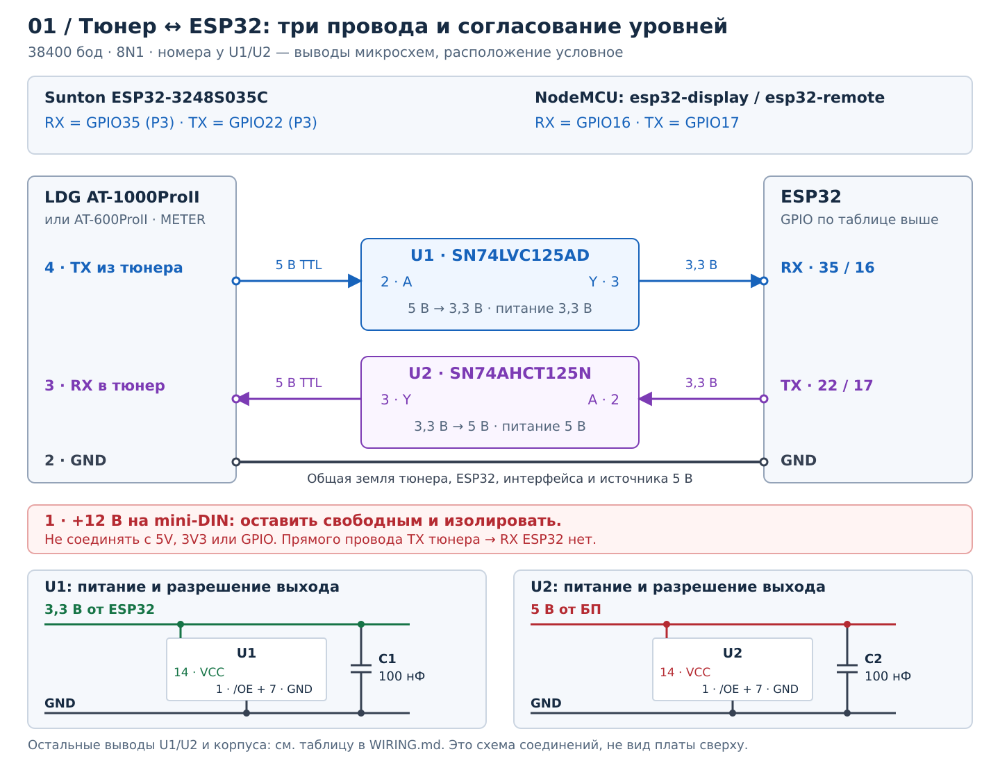
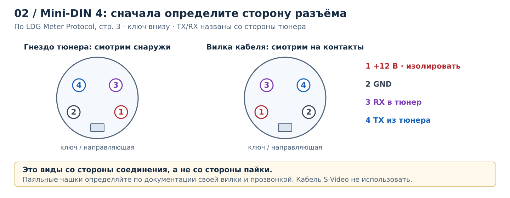
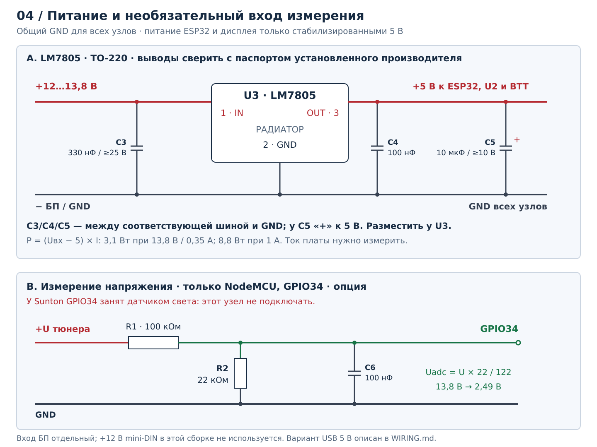

# Схема пайки LDG ↔ ESP32

Сначала выберите свою плату. Номера GPIO соответствуют
[include/config.h](include/config.h) и [include/User_Setup.h](include/User_Setup.h).
На рисунках показаны электрические соединения: положение контактов ESP32
условное, при пайке ориентируйтесь на маркировку своей платы.

| Плата / прошивка | Вход RX от тюнера | Выход TX в тюнер | Экран |
|---|---|---|---|
| **Sunton ESP32-3248S035C** / `esp32-3248s035c` | **GPIO35, P3** | **GPIO22, P3** | Уже подключён на плате |
| NodeMCU ESP32 / `esp32-display` | GPIO16 | GPIO17 | Внешний BTT, схема 03 |
| NodeMCU ESP32 / `esp32-remote` | GPIO16 | GPIO17 | Не нужен |

## 01. Тюнер и согласование UART

[Открыть схему UART крупно](docs/wiring/tuner-uart.svg).

По LDG Meter Protocol контакт 1 —
**+12 В**, 3 — **вход тюнера**, 4 — **выход тюнера**.
В этой сборке контакт 1 оставляем свободным и изолируем; ESP32 питаем отдельно.

Интерфейс тюнера: **38400 бод, 8N1, TTL 0–5 В**. GPIO ESP32 работают
с 3,3 В. Ниже приведён конкретный вариант согласования на двух
неинвертирующих буферах; названия U1/U2 относятся к рисунку.

| Обозначение | Деталь | Исполнение для сборки |
|---|---|---|
| U1 | **SN74LVC125AD** | SOIC-14 на переходнике SOIC-14 → DIP-14; питание **3,3 В**, вход допускает 5 В |
| U2 | **SN74AHCT125N** | DIP-14; питание **5 В**, вход совместим с TTL и принимает 3,3 В |
| C1, C2 | 100 нФ, керамика | По одному между выводами 14 и 7 каждой микросхемы, рядом с корпусом |

U1 принимает данные тюнера и выдаёт 3,3 В на RX ESP32. U2 повышает уровень
TX ESP32 до 5 В для входа тюнера. Используется первый канал каждого буфера.
Не заменяйте U1/U2 произвольной микросхемой с похожим названием: допустимые
напряжения входов и пороги переключения у семейств различаются.

### Куда припаять сигнальные провода

| Откуда | Куда | Назначение |
|---|---|---|
| Mini-DIN **4**, TX из тюнера | U1, вывод **2** (1A) | Данные 5 В в интерфейс |
| U1, вывод **3** (1Y) | Sunton **GPIO35 на P3** / NodeMCU **GPIO16** | Данные 3,3 В в ESP32 |
| Sunton **GPIO22 на P3** / NodeMCU **GPIO17** | U2, вывод **2** (1A) | Команды 3,3 В из ESP32 |
| U2, вывод **3** (1Y) | Mini-DIN **3**, RX в тюнер | Команды 5 В в тюнер |
| Mini-DIN **2**, GND | GND ESP32, U1/U2 и минус источника 5 В | Общая земля |
| Mini-DIN **1**, +12 В | **Не подключать**, изолировать | Питание внешнего метра, здесь не используется |

### Питание и остальные выводы U1/U2

Нумерация — по корпусу микросхемы, **вид сверху**, метка вывода 1 у выемки
или точки. Переходник для U1 должен сохранять эти номера; проверьте его
дорожки прозвонкой.

| Вывод | Сигнал | U1, SN74LVC125AD | U2, SN74AHCT125N |
|---|---|---|---|
| **14** | VCC | **3V3 от ESP32** | **+5 В от источника питания** |
| **7** | GND | Общая земля | Общая земля |
| **1** | /1OE | GND: первый канал включён | GND: первый канал включён |
| **2** | 1A | Mini-DIN 4 | TX ESP32 |
| **3** | 1Y | RX ESP32 | Mini-DIN 3 |
| 4, 10, 13 | /2OE, /3OE, /4OE | **3,3 В**: остальные каналы выключены | **5 В**: остальные каналы выключены |
| 5, 9, 12 | 2A, 3A, 4A | GND: не оставлять входы висящими | GND: не оставлять входы висящими |
| 6, 8, 11 | 2Y, 3Y, 4Y | Не подключать | Не подключать |

У Sunton сигналы UART и GND берите с **P3**, а **3V3 для U1 — с CN1,
с контакта V3.3**. На P3 линии 3,3 В нет. Ориентацию CN1 и напряжение
контакта проверьте на своей ревизии до подключения. Питание U2 берите
с той же стабилизированной шины 5 В, которая питает плату.
Разъём P1 с TX/RX используется для USB–UART и прошивки.
GPIO16/17 у Sunton заняты RGB-светодиодом.

Держите интерфейс рядом с ESP32, провода короткими. Соединяйте кабель
при выключенном питании; U1/U2 должны быть запитаны при обмене с тюнером.
Отдельного провода +12 В от mini-DIN к интерфейсу нет.

## 02. Mini-DIN: какой контакт где

[Открыть виды разъёма крупно](docs/wiring/tuner-connector.svg).

Слева — **вид в гнездо на задней панели тюнера**, как в документе LDG.
Справа — ответная вилка **со стороны контактов**, ключ внизу.
Сторона пайки вилки здесь не показана: расположение чашек и выводов зависит
от исполнения разъёма. Определяйте их по паспорту конкретной вилки и
прозванивайте до доступной контактной части.

Обозначения LDG: **METERRX** (контакт 3) означает «тюнер принимает от метра»,
**METERTX** (контакт 4) — «тюнер передаёт метру».
Кабель **S-Video не использовать**: совпадение формы разъёма не гарантирует
нужные соединения. Нужна проверенная распайка трёх отдельных проводов.

Источник распиновки: **LDG External Meter Serial Communications Protocol
Specification, стр. 3**, [копия документа LDG в LDGControl](https://github.com/Efpophis/LDGControl/blob/master/MeterProtocol.pdf).

## 03. Внешний дисплей BTT — только NodeMCU

Для Sunton этот раздел пропускается: экран и тачскрин уже соединены с ESP32.

[Открыть схему BTT крупно](docs/wiring/btt-display.svg).

| Контакт BTT, XH2.54 | Сигнал | Куда припаять на NodeMCU |
|---|---|---|
| 1 | IORQ, touch IRQ | GPIO39 / SVN |
| 2 | SCL | GPIO22 |
| 3 | SDA | GPIO21 |
| 4 | RS / DC | GPIO15 |
| 5 | NSS / CS | GPIO5 |
| 6 | SCK | GPIO18 |
| 7 | MOSI | GPIO23 |
| 8 | MISO | GPIO19 |
| 9 | GND | Общая земля |
| 10 | +5V | Стабилизированные +5 В |

На этой плате LCD ILI9488 работает по **SPI**, а тач NS2009 — по **I2C**
(адрес `0x48`); логические уровни BTT — 3,3 В, питание — 5 В.
Ищите начало разъёма по маркировке **IORQ / +5V** и
[распиновке производителя BTT](https://bttwiki.com/TFT35%20SPI.html).

В 10-контактном разъёме **нет RST и BL**. В прошивке для внешнего дисплея
задан `TFT_BL = 32`, но штатный кабель BTT не выводит эту линию:
отдельный провод GPIO32 в этот разъём не паять.

## 04. Питание и измерение напряжения

[Открыть схему питания крупно](docs/wiring/power.svg).

### Питание от готового источника 5 В

Для первоначальной сборки можно использовать стабилизированный **5 В / 1 А**
источник, указанный для Sunton: +5 В на штатный вход питания платы,
минус — на GND. U2 питается от этих же +5 В, U1 — от 3V3 платы.
При питании платы от USB шину для U2 берите только с проверенного вывода 5V
платы. Не соединяйте два независимых источника 5 В, включая USB компьютера,
без проверки схемы развязки конкретной платы.

### Питание от 12–13,8 В через LM7805

Это **отдельный вход от блока питания**, не контакт 1 mini-DIN.
Для LM7805 в TO-220, при взгляде на маркировку, ножки вниз:
**1 IN — 2 GND — 3 OUT**; для указанного TI TO-220 металлическая площадка
соединена с GND. Сверьте корпус и распиновку купленной детали.

| Деталь / вывод | Куда подключить |
|---|---|
| U3 LM7805, 1 IN | +12–13,8 В источника |
| U3, 2 GND | Минус источника и общая земля |
| U3, 3 OUT | +5 В к ESP32, U2 и, если есть, BTT |
| C3, 330 нФ, ≥25 В | Между IN и GND, рядом с U3 |
| C4, 100 нФ | Между OUT и GND, рядом с U3 |
| C5, 10 мкФ, ≥10 В | **Плюс к OUT**, минус к GND |
| Радиатор TO-220 | На U3; размер по измеренному току и температуре |

Все конденсаторы стоят **параллельно** соответствующей шине питания.
Последовательного включения конденсатора в провод +12 В или +5 В нет.

Тепловая мощность: `P ≈ (Uвх − 5 В) × I`. При 13,8 В и 350 мА это
**3,1 Вт**, при 1 А — **8,8 Вт**. Подбирайте радиатор по фактическому
току нагрузки и температуре стабилизатора.

### Необязательный делитель на GPIO34 — только NodeMCU

На схеме 04B верхний резистор **R1 = 100 кОм** идёт от плюса питания
**тюнера** к измерительной точке. От этой точки подключены три ветви:
**GPIO34**, **R2 = 22 кОм на GND** и **C6 = 100 нФ на GND**.
Конденсатор параллелен R2. Используйте резисторы с допуском 1%.

- `Uadc = Uтюнера × 22 / 122`; при 13,8 В получается примерно **2,49 В**.
- Коэффициент в прошивке — `5.545`; программный диапазон — 8–18 В.
  Он не ограничивает напряжение физически. Не подавайте на делитель больше
  18 В; защита от выбросов в этом базовом рисунке не предусмотрена.
- Для защиты ADC от выбросов подбирайте TVS по напряжению ограничения и току,
  а не только по маркировке «3,3 В».
- Без делителя используется напряжение из настроек веб-интерфейса,
  по умолчанию 13,8 В. **На Sunton GPIO34 занят датчиком света**,
  измерение PSU отключено в прошивке: внешний делитель туда не паять.

## Детали для сборки

| Деталь | Количество | Когда нужна |
|---|---|---|
| Sunton ESP32-3248S035C **или** NodeMCU ESP32 | 1 | Выбрать одну плату |
| Вилка mini-DIN 4, отдельные провода, термоусадка | 1 комплект | Соединение с тюнером |
| U1 SN74LVC125AD + переходник SOIC-14 → DIP-14 | 1 + 1 | Приём 5 В → 3,3 В |
| U2 SN74AHCT125N | 1 | Передача 3,3 В → 5 В |
| C1/C2, 100 нФ | 2 | Развязка питания буферов |
| Стабилизированный источник 5 В | 1 | Либо узел LM7805 ниже |
| U3 LM7805 + радиатор, C3 330 нФ, C4 100 нФ, C5 10 мкФ | 1 комплект | Если питание от 12–13,8 В |
| BTT TFT35-SPI V2.1 + 10-проводный кабель XH2.54 | 1 комплект | Только `esp32-display` |
| R1 100 кОм, R2 22 кОм, C6 100 нФ | По 1 | Необязательный ADC NodeMCU |

## Порядок сборки и проверки

1. При отключённом питании определите контакты mini-DIN прозвонкой,
   изолируйте контакт 1. Подпишите три провода: **GND, RX в тюнер, TX из тюнера**.
2. Соберите питание и измерьте +5 В и 3V3 до подключения сигнальных проводов.
   Для U1 и U2 соблюдайте разные напряжения VCC.
3. Соедините все GND, установите C1/C2, подключите /OE и неиспользуемые
   входы буферов по таблице. Затем припаяйте две сигнальные цепочки схемы 01.
4. Для NodeMCU с дисплеем добавьте десять соединений схемы 03.
   Для `esp32-remote` достаточно питания и интерфейса UART;
   для Sunton внешний дисплей не подключается.
5. Проверьте отсутствие короткого замыкания питания и связь каждой жилы
   до нужного вывода. После включения проверьте уровни UART, обмен
   с тюнером и нагрев стабилизатора под нагрузкой.

При первом запуске точка доступа: **`LDGConfig`**, пароль **`configure`**.
Настройте Wi-Fi через портал. Установка прошивки Sunton описана в
[руководстве платы](docs/boards/esp32-3248s035c.md).

Источники: [документ LDG, стр. 3](https://github.com/Efpophis/LDGControl/blob/master/MeterProtocol.pdf),
[TI SN74LVC125A](https://www.ti.com/lit/ds/symlink/sn74lvc125a.pdf),
[TI SN74AHCT125](https://www.ti.com/lit/ds/symlink/sn74ahct125.pdf),
[TI LM7805 / LM340](https://www.ti.com/lit/ds/symlink/lm340.pdf),
[Sunton P3/CN1 и питание](https://esp3d.io/esp3d-tft/version_1x/hardware/esp32/sunton-35-3248/),
[BTT TFT35 SPI](https://bttwiki.com/TFT35%20SPI.html).
